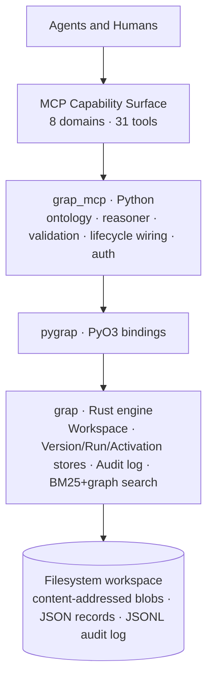
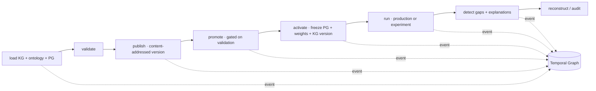

# grap + MCP: A Graph-Native Engine for KG, PG & Temporal Graph

**Thesis:** One graph engine, three meanings. `grap` (a fast Rust knowledge-graph
engine) stores everything as nodes + edges; the MCP layer gives agents and humans a
governed, auditable way to drive three *kinds* of graph — Knowledge, Procedure, and
Temporal — to turn project knowledge and process logic into explainable, reproducible
ASPICE gap analysis.

---

## The three graphs

| Graph | Role | Answers | In grap terms |
|-------|------|---------|---------------|
| **Knowledge Graph (KG)** | Source of truth | *What do we know?* | grap nodes + edges + BM25/graph search; an ASPICE ontology projected as outcome/characteristic nodes with `requires` edges |
| **Procedure Graph (PG)** | Execution logic | *How do we do it?* | A human YAML procedure projected into grap (data-flow + reference edges), captured as immutable content-addressed **versions** and **activations** |
| **Temporal Graph (TG)** | Audit / history | *What happened, when, and why?* | An append-only event log turned into a **relational event graph** (typed links) plus run records and immutable explanation records |

KG provides truth, PG provides logic, TG provides history. The same primitive —
nodes and connections — carries all three; only the *meaning* differs.

---

## Layered architecture

Each layer owns one concern and talks to the next through a narrow interface:

- **grap (Rust engine)** — the durable authority: a content-addressed `Workspace`
  (VersionStore, ActivationStore, RunStore, append-only AuditLog), property-bitmask +
  BM25 full-text + graph traversal search, atomic on-disk persistence.
- **pygrap (PyO3 bindings)** — exposes the engine + lifecycle `Workspace` to Python.
- **grap_mcp (Python)** — the domain layer: ontology parsing/projection, the hybrid
  gap-detection reasoner, publish-time validation, and lifecycle/governance wiring.
- **MCP capability surface** — 31 tools across 8 domains; the *only* interface agents
  and humans need.
- **Agents & humans** — drive everything through capabilities; no "secret" direct API.

---

## How KG / PG / TG map onto grap

**Knowledge Graph.** Documents and requirements become grap nodes with rich,
strength-weighted edges; full-text (BM25) + graph traversal retrieve them. The ASPICE
**ontology** is parsed from YAML and *projected* into the same KG: each process
outcome and required characteristic becomes a labelled node
(`kg:aspice.process_outcome.*`, `kg:aspice.characteristic.*`) joined by `requires`
edges, and is versioned as a content-addressed `Ontology` snapshot.

**Procedure Graph.** A human-edited flat YAML procedure is parsed and projected into
grap: steps become nodes, explicit `step.outputs.*` references become data-flow edges,
and `kg:` references resolve to KG nodes. The procedure is published as an immutable,
content-addressed **version** (Draft → Promoted, gated by validation), and an
**activation** freezes a (PG version + governed weights + KG/ontology version) triple
for reproducibility.

**Temporal Graph.** Every mutating capability appends an immutable `AuditEvent` to a
JSONL log. Events carry typed **links** (`{relation, kind, id}` → run, version,
explanation, …), turning the log into a queryable relational event graph:
`events_for_run`, `events_linked_to`, filtered timeline queries. Each execution writes
a **run record** (production or experiment) that references the frozen versions and the
immutable **explanation records** it produced — enabling `reconstruct(run_id)` to
report exactly what logic, weights, and knowledge a past run used (and flag any missing
artifact).

The reasoner is **hybrid**: for each in-scope process outcome it checks every required
characteristic using a structural signal (when present) and a lexical signal (a
mapping-hint-weighted BM25 search over real KG content, deterministically excluding
system-projected nodes — the ontology scaffolding *and* the procedure's own step
nodes — by node id so they are never mistaken for evidence). Unsatisfied
characteristics become gaps, each with a sectioned,
reproducible explanation (structured + statistical + rendered snapshot).

---

## Governance & reproducibility

Every state change is deliberate and auditable:

- **Gated publishing.** Draft is low-friction; promotion is **refused if validation
  has errors** (structure + `kg:` reference validity + ontology-outcome validity), and
  only a Promoted version can be activated.
- **Frozen, governed weights.** A small weight set (e.g. `lexical_threshold`) is
  changed only with a mandatory rationale (audited), and is **frozen into the
  activation** so a run is reproducible.
- **Roles.** `viewer < operator < admin` gate the surface — operator for
  lifecycle/execution, admin for governance + retention; reads are open.
- **Retention.** `enforce_retention` hard-deletes runs past their kind's window plus
  their orphaned explanation records, and audits the sweep.

Every one of these emits a Temporal-Graph event, so "what happened and why" is always
answerable.

---

## Capability surface (8 domains, 31 tools)

| Domain | Representative tools |
|--------|----------------------|
| knowledge | `load_knowledge_graph`, `load_ontology` |
| pg_lifecycle | `load_procedure_graph`, `publish_pg`, `promote_pg`, `activate`, `set_production` |
| execution_reasoning | `run_procedure`, `detect_gaps`, `get_explanation` |
| experimentation | `run_experiment`, `get_quality_metrics`, `adopt_experiment` |
| validation | `validate_procedure_graph`, `diff_procedure_graphs`, `get_validation` |
| governance | `get_config`, `set_weight`, `set_retention`, `enforce_retention` |
| auth | `set_role`, `get_role` |
| audit | `get_audit_log`, `list_runs`, `reconstruct_run`, `query_events`, `list_capabilities` |

Full reference: [`mcp-server/CAPABILITIES.md`](../mcp-server/CAPABILITIES.md). Live
walkthrough: [`mcp-server/demo_aspice_e2e.py`](../mcp-server/demo_aspice_e2e.py).

---

## Suggested infographic layout

A single-page infographic, top to bottom. Numbers to feature: **3 graphs · 5 layers ·
8 domains · 31 capabilities**.

1. **Hero band (top).** Title + thesis ("one graph engine, three meanings"). Three
   icons in a row: KG = database/checkmark (truth), PG = flowchart/gears (process),
   TG = timeline/clock (history). Suggested palette: KG **blue**, PG **green**,
   TG **amber** — reuse these accents throughout.

2. **Three-graph triptych.** Three color-coded columns (KG / PG / TG), each with
   *Role*, *Answers* (the question), and *In grap terms*. A thin caption beneath:
   "KG → PG → TG; truth feeds logic, logic produces history; history feeds back into
   truth."

3. **Layer stack (left or center).** Five stacked slabs with a downward arrow:
   Agents & Humans → MCP Capability Surface → grap_mcp (Python) → pygrap (PyO3) →
   grap (Rust engine) → ⟶ Filesystem workspace. Label what each slab owns in one
   phrase. Emphasize the bottom slab (Rust) as "the durable authority".

4. **Lifecycle ribbon (center, horizontal).** A left-to-right arrow flow:
   load → validate → publish → promote → activate → run → detect gaps → reconstruct.
   Beneath it, a parallel **Temporal Graph rail** (amber) with small "event" ticks
   dropping from each step into the rail — visually showing the TG records everything.
   Put a small lock icon on **promote** (gated) and a snowflake on **activate**
   (frozen weights).

5. **Governance callouts (bottom band).** Four chips with icons:
   🔒 *gated publish* · ❄ *frozen weights* · 👤 *roles (viewer/operator/admin)* ·
   🗑 *retention enforcement* — each tagged "audited".

6. **Footer.** The key numbers strip (3 · 5 · 8 · 31) and a one-line outcome:
   "Auditable, traceable, reproducible, governed ASPICE gap detection."

Arrow direction overall: downward for the layer stack, rightward for the lifecycle
ribbon, with the TG as a horizontal rail underpinning the whole flow.
