Below is a **Markdown equivalent** of the 5-image set. It preserves the same conceptual structure, but uses headings, tables, and Mermaid diagrams instead of visual poster layout.

---

# 1. Graph-Native Test Specification System

## Text description and conceptual understanding

This system automatically generates **automotive test specifications** for specific functionalities by combining:

1. project knowledge,
2. reusable procedure logic,
3. auditable execution history.

The system evolves from an older, ad-hoc, prompt-driven approach into a **graph-native architecture** built around three complementary graph types:

| Graph                         | Role                | Answers                       |
| ----------------------------- | ------------------- | ----------------------------- |
| **Knowledge Graph — KG**      | Source of truth     | What do we know?              |
| **Procedure Graph — PG / TG** | Execution logic     | How do we do it?              |
| **Temporal Graph**            | Audit/history layer | What happened, when, and why? |

> In this context, **TG and PG are interchangeable** when referring to the executable procedure: both mean a **Procedure Graph**, a grouped list of executable instructions or steps.

---

## From the old approach

Historically, Python scripts gathered content from an ad-hoc Knowledge Graph: instructions, templates, and checklists. The scripts concatenated that material into a dynamic prompt for an LLM. The LLM then followed that prompt to generate test specifications.

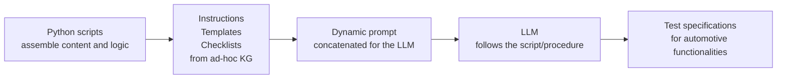

The old approach worked, but much of the execution logic was hidden inside prompt assembly.

---

## Why change

### Limitations of the ad-hoc method

| Problem                | Meaning                                                                |
| ---------------------- | ---------------------------------------------------------------------- |
| Fragile maintenance    | Script logic and prompt structure are difficult to update safely.      |
| Limited reuse          | Prompt fragments are not first-class reusable components.              |
| Opaque prompt assembly | It is hard to know exactly why a prompt contained certain content.     |
| Poor auditability      | The system does not naturally record what was used and why.            |
| Difficult debugging    | Root-cause analysis is slow because intermediate decisions are hidden. |
| Weak traceability      | Inputs, steps, and outputs are not reliably connected end-to-end.      |

### Benefits of graph-native architecture

| Benefit               | Meaning                                                  |
| --------------------- | -------------------------------------------------------- |
| Structured knowledge  | Project knowledge becomes queryable and governed.        |
| Reusable procedures   | Execution logic becomes modular and composable.          |
| Explicit traceability | Inputs, decisions, and outputs are linked.               |
| Audit history         | Every relevant event can be recorded.                    |
| Easier debugging      | Failures can be traced through KG + PG + Temporal Graph. |

---

## Core architectural idea

The system is built from the same primitive everywhere:

> **nodes + connections = graphs**

The difference is not the primitive, but the meaning of the graph.

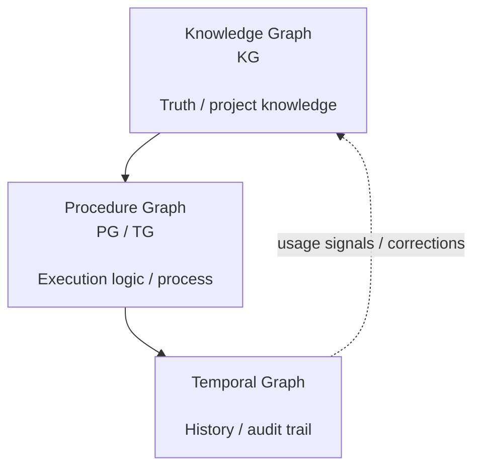

---

## The three graph types

### 1. Knowledge Graph — KG

The KG captures and organizes project knowledge extracted from raw documents and other sources.

It may include:

| Element        | Description                                                             |
| -------------- | ----------------------------------------------------------------------- |
| Requirements   | Functional and non-functional requirements.                             |
| Signals        | Inputs, outputs, interfaces, network signals.                           |
| Constraints    | Rules, timing limits, compliance constraints.                           |
| Templates      | Reusable test-specification or checklist structures.                    |
| Glossary terms | Normalized terminology.                                                 |
| Relations      | Links between requirements, signals, constraints, tests, and templates. |

The KG is expected to be created from chunked raw text files, summarized, and organized into a queryable graph. It may also contain an **index table** for fast lookup.

Edges can carry metadata such as:

| Edge metadata       | Purpose                                |
| ------------------- | -------------------------------------- |
| Confidence          | How reliable the connection is.        |
| Visit count         | How often the relationship was used.   |
| Lifetime / validity | When the relation is valid or expired. |

An ontology can be imposed on top of the KG to normalize concepts and relationship types.

---

### 2. Procedure Graph — PG / TG

The PG is the explicit replacement for the old dynamic prompt.

It is a graph of discrete executable steps. Each step references:

| Step field | Meaning                 |
| ---------- | ----------------------- |
| Inputs     | What the step consumes. |
| Operation  | What the step does.     |
| Outcome    | What the step produces. |

The PG can contain branching, loops, validation, and reusable subprocedures.

The PG is invoked to perform the work that the old dynamic prompt implicitly described.

---

### 3. Temporal Graph

The Temporal Graph records what happened during execution.

It captures:

| Event data        | Meaning                                               |
| ----------------- | ----------------------------------------------------- |
| Timestamp         | When something happened.                              |
| Actor/component   | Who or what performed it.                             |
| Input references  | What data was used.                                   |
| Output references | What artifact was produced.                           |
| Decisions         | Which branches, rules, or model decisions were taken. |
| Errors/retries    | What failed and how it was retried.                   |
| Review events     | Human validation, corrections, approvals.             |

The Temporal Graph makes the system auditable, traceable, reproducible, and debuggable.

---

## Conceptual 3-axis model

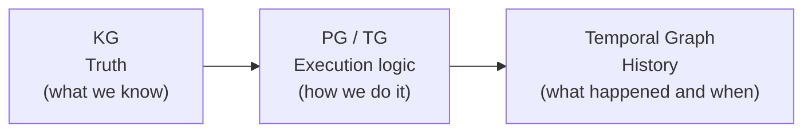

Together:

> **KG provides truth. PG provides execution logic. Temporal Graph provides history.**

The system outcome is an automatic, graph-native platform that transforms requirements and project knowledge into high-quality automotive test specifications while remaining explainable, auditable, traceable, and debuggable.

---

# 2. Architecture Evolution: From Dynamic Prompting to Graph-Native Processing

## How the original ad-hoc prompt pipeline evolves into a structured, auditable system

The earlier system used Python scripts to concatenate instructions, templates, and checklists gathered from an ad-hoc KG. This produced a dynamic prompt for an LLM. The LLM generated test specifications for automotive functionalities, but the process was hard to maintain, reuse, and audit.

---

## Old approach

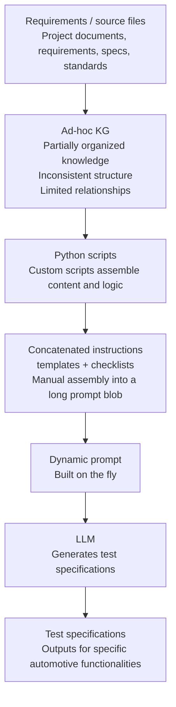

### Weaknesses

| Weakness               | Why it matters                                                |
| ---------------------- | ------------------------------------------------------------- |
| Fragile maintenance    | Changes can break hidden assumptions in scripts or prompts.   |
| Limited reuse          | Prompt fragments are hard to reuse as stable components.      |
| Opaque prompt assembly | The final prompt may be difficult to inspect or explain.      |
| Poor auditability      | It is unclear exactly what knowledge was used.                |
| Difficult debugging    | Failures require reconstructing hidden prompt-building logic. |
| Weak traceability      | Source → decision → output links are incomplete.              |

---

## New graph-native approach

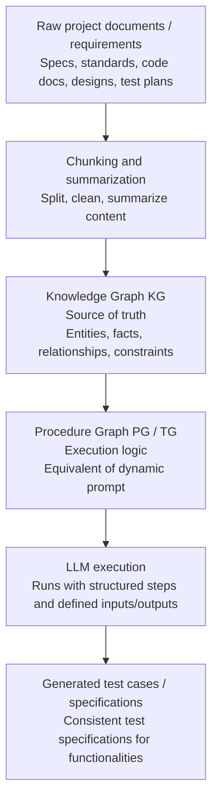

The Temporal Graph records every major event:

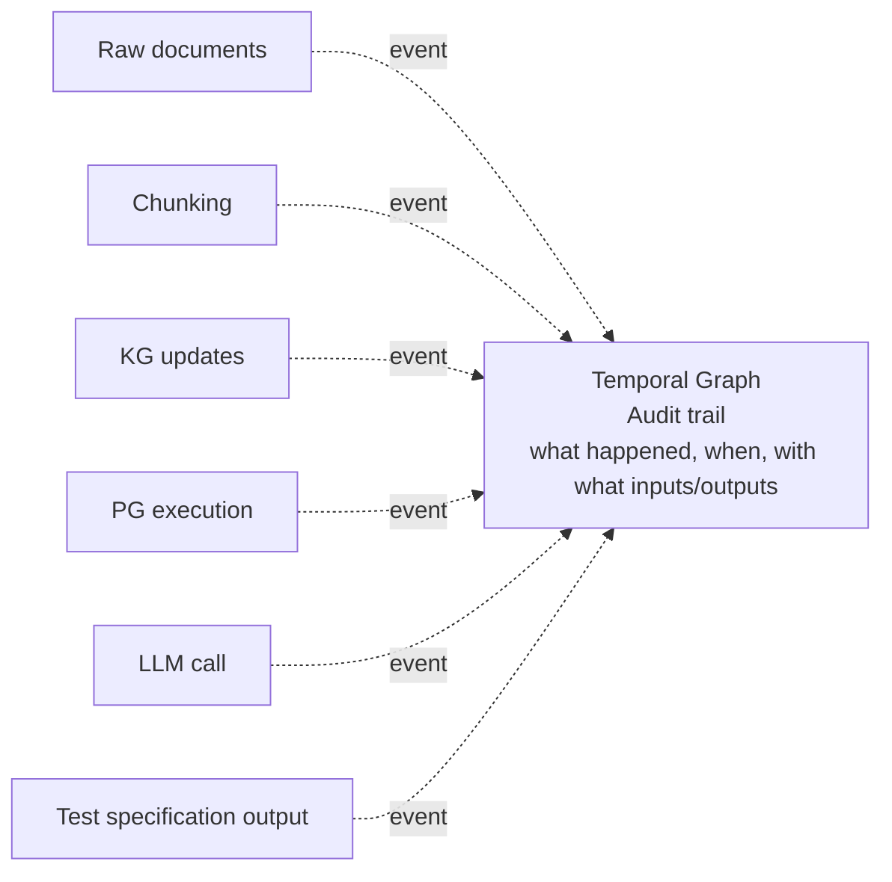

---

## What improves

| Improvement           | Explanation                                                                        |
| --------------------- | ---------------------------------------------------------------------------------- |
| Structured knowledge  | A governed KG becomes the single source of truth.                                  |
| Reusable procedures   | PG encodes execution logic that can be reused across projects and functionalities. |
| Explicit traceability | Every input, step, and output can be linked end-to-end.                            |
| Audit history         | Temporal Graph captures a complete history of events and decisions.                |
| Easier debugging      | Reproducible context and history make root-cause analysis faster.                  |

> TG and PG are interchangeable in this context: both refer to the **Procedure Graph**, the executable logic that replaces the old dynamic prompt.

---

# 3. Knowledge Graph — KG: The Source of Truth

## How raw project information becomes structured, queryable knowledge

The Knowledge Graph is built from chunked raw text files and related project sources. AI summarizes content, extracts entities and relationships, and structures them into a living, queryable knowledge base.

---

## KG creation pipeline

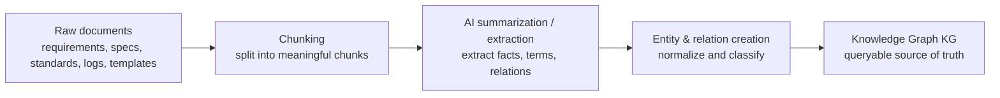

---

## Example KG structure

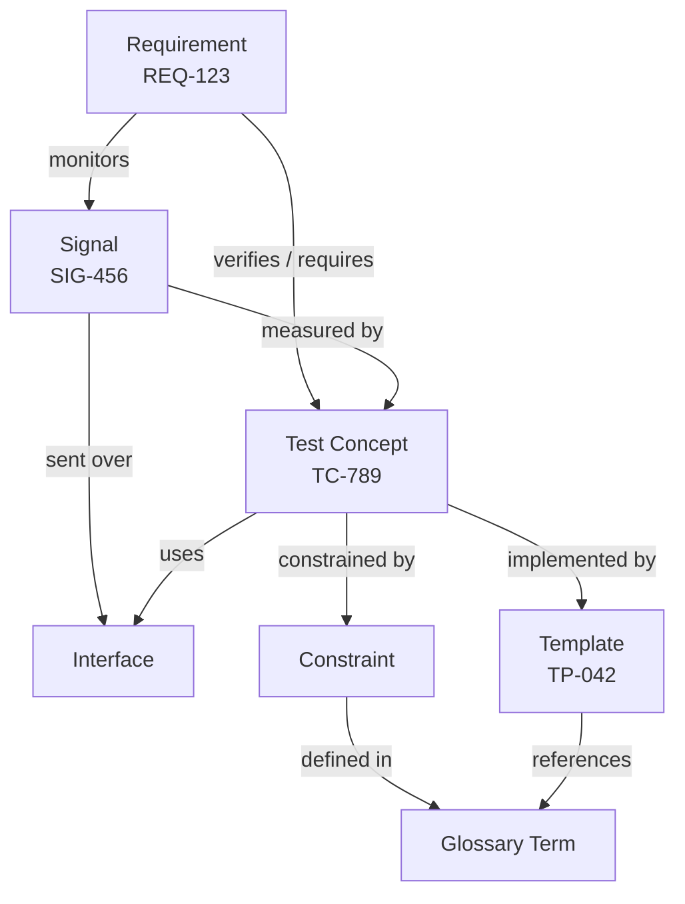

---

## Possible KG support structures

| Support structure        | Purpose                                                             |
| ------------------------ | ------------------------------------------------------------------- |
| Index table              | Maps entities and aliases to unique IDs for fast retrieval.         |
| Metadata                 | Stores types, attributes, timestamps, status, and descriptive data. |
| Provenance links         | Links every entity and relation to source chunks and documents.     |
| Ranking / retrieval aids | Stores relevance scores, embeddings, and usage signals.             |

---

## Rich edge semantics

Connections are not just simple links. Edges can carry meaning and operational metadata.

| Edge attribute       | Meaning                                                    |
| -------------------- | ---------------------------------------------------------- |
| Relationship type    | Example: verifies, constrains, references, implemented by. |
| Confidence           | How confident the system is in the relationship.           |
| Visitation frequency | How often this relationship has been used or retrieved.    |
| Lifetime / validity  | When the relationship is valid: start, end, or ongoing.    |
| Provenance           | Which source chunk/document supports the edge.             |

---

## Ontology on top

An ontology can sit above the KG and define how knowledge is modeled.

| Ontology function                 | Explanation                                             |
| --------------------------------- | ------------------------------------------------------- |
| Normalize concepts                | Map synonyms and variants to canonical terms.           |
| Define allowed relationship types | Restrict which entity categories may be connected.      |
| Support consistent interpretation | Ensure shared meaning across teams, projects, and time. |

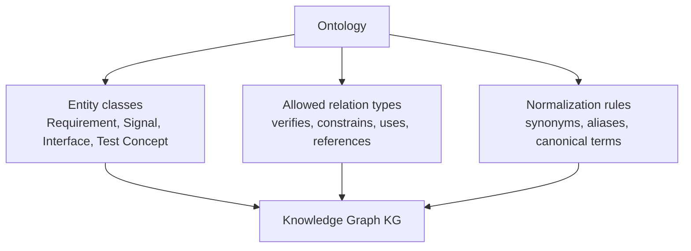

---

## Why KG matters

| Reason                  | Value                                                           |
| ----------------------- | --------------------------------------------------------------- |
| Source of truth         | One authoritative representation of project knowledge.          |
| Queryable knowledge     | Ask precise questions with traceable context.                   |
| Reuse across procedures | The same knowledge can feed multiple test-generation workflows. |
| Better governance       | Structure makes knowledge manageable and auditable.             |
| Higher consistency      | Aligned terminology reduces ambiguity and rework.               |

---

## Example query path

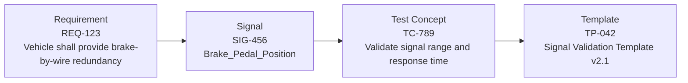

From a requirement, the system can find the related signal, identify the relevant test concept, and select the template used to implement the test specification.

---

# 4. Procedure Graph — PG / TG: Execution Logic

## The modern, explicit replacement for the old dynamic prompt

In this context, **PG and TG are interchangeable** and refer to the same concept: a **Procedure Graph**.

A Procedure Graph is a structured, executable graph of grouped instructions. It transforms inputs and referenced knowledge into a well-defined, verifiable output.

---

## PG references the KG

The PG does not operate in isolation. It pulls facts, rules, templates, checklists, constraints, and relationships from the KG.

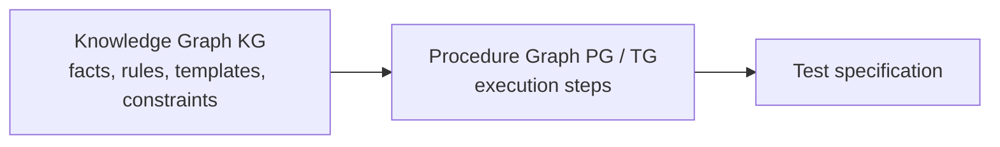

---

## Main procedure flow

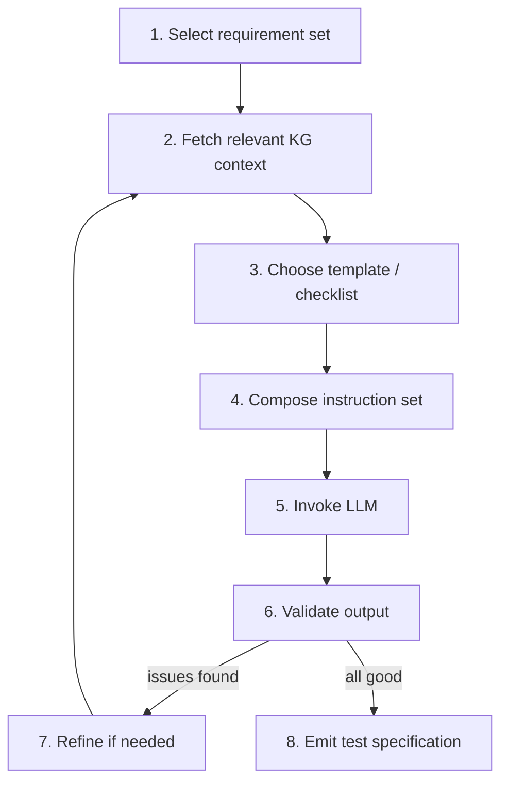

---

## Procedure step structure

Each PG node should expose the same basic contract:

| Field     | Meaning                 |
| --------- | ----------------------- |
| Inputs    | What the step consumes. |
| Operation | What the step performs. |
| Outcome   | What the step produces. |

---

## Example PG nodes

| Step                      | Inputs                           | Operation                                    | Outcome                            |
| ------------------------- | -------------------------------- | -------------------------------------------- | ---------------------------------- |
| Select requirement set    | Project, scope, user selection   | Identify applicable requirements             | Selected requirements + metadata   |
| Fetch relevant KG context | Requirements, domain, scope      | Query KG for related facts, rules, templates | Context bundle                     |
| Choose template/checklist | Context bundle, requirements     | Select best-fit templates/checklists         | Template + checklist selection     |
| Compose instruction set   | Template, context, rules         | Assemble instructions and guardrails         | Instruction payload for LLM        |
| Invoke LLM                | Instruction set, context         | Generate draft output                        | Raw test specification             |
| Validate output           | Draft output, rules, constraints | Check completeness, consistency, compliance  | Pass/issues result                 |
| Refine if needed          | Issues, draft output, context    | Refine instructions or augment context       | Updated instruction/context        |
| Emit test specification   | Validated output, trace links    | Format, attach metadata, link to sources     | Final traceable test specification |

---

## KG inputs into PG steps

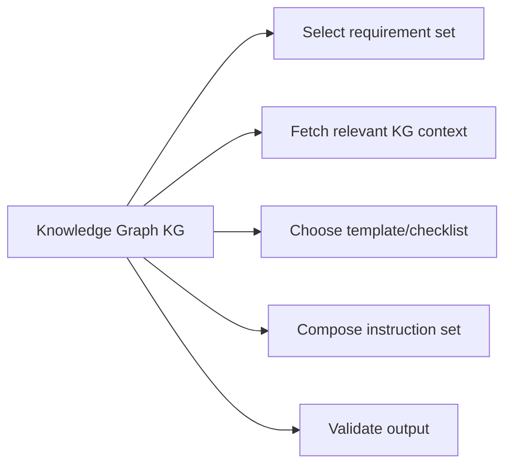

The KG provides:

| KG content               | Used by PG for                             |
| ------------------------ | ------------------------------------------ |
| Facts                    | Requirement interpretation.                |
| Rules and constraints    | Validation, guardrails, compliance checks. |
| Templates and checklists | Test-specification structure.              |
| Relationships            | Traceability and dependency resolution.    |

---

## What a PG encodes

| PG concept             | Meaning                                             |
| ---------------------- | --------------------------------------------------- |
| Step order             | The explicit sequence of operations.                |
| Dependencies           | What each step requires from previous steps or KG.  |
| Branching              | Alternative paths based on conditions.              |
| Decision logic         | Conditions, checks, and thresholds that drive flow. |
| Reusable subprocedures | Encapsulated step groups that can be reused.        |
| Expected outputs       | Defined outputs and evidence at each step.          |

---

## Why PG matters

| Reason                       | Value                                                 |
| ---------------------------- | ----------------------------------------------------- |
| Replaces hidden prompt logic | Makes execution explicit and inspectable.             |
| Makes execution composable   | Steps can be reused, reordered, or extended.          |
| Supports maintenance         | Easier to update steps, rules, templates, and checks. |
| Improves explainability      | Every decision and output can be traced.              |
| Allows controlled automation | Validation, guardrails, and loops improve quality.    |

---

## Equivalent to the former dynamic prompt

What used to be implicitly gathered and concatenated into a dynamic prompt is now modeled explicitly as a reusable graph procedure.

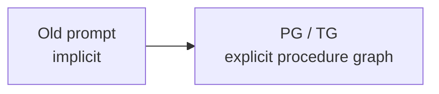

The same inputs and knowledge still drive the process, but the steps, guards, decisions, and outputs are now visible, reusable, and auditable.

---

# 5. Temporal Graph and Full-System Traceability

## History, auditability, and how KG + PG + Temporal Graph complete the picture

The Temporal Graph records what happened in the automatic processing system: every event, decision, artifact, and transition over time.

By linking each event back to the Knowledge Graph and Procedure Graph, the generation of test cases becomes auditable, traceable, reproducible, and debuggable.

---

## Temporal Graph event timeline

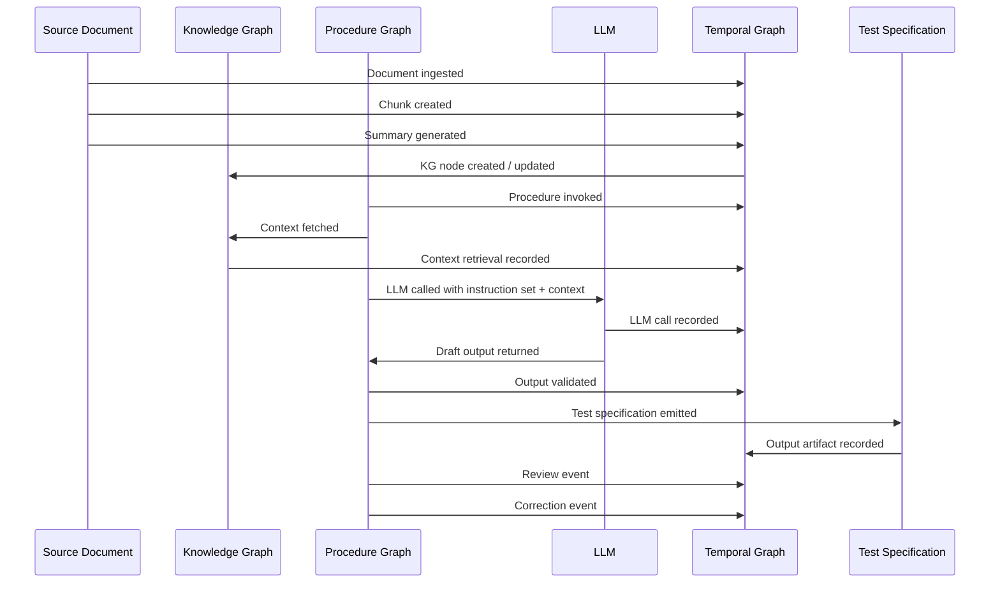

---

## Example temporal event table

| Time         | Event             | Description                                  | KG link                  | PG link                        |
| ------------ | ----------------- | -------------------------------------------- | ------------------------ | ------------------------------ |
| 10:00:01.123 | Document ingested | Requirement document received and registered | Document DOC-REQ-1234    | Ingest Document, PG Step 1.1   |
| 10:00:02.456 | Chunk created     | Text chunk produced from document            | TextChunk CH-00045       | Chunk Document, PG Step 1.2    |
| 10:00:03.789 | Summary generated | LLM summary created for chunk                | Summary SUM-00078        | Summarize Text, PG Step 2.1    |
| 10:00:04.982 | KG node created   | New/updated entity added to KG               | Requirement REQ-000567   | Update KG, PG Step 2.3         |
| 10:00:06.201 | Procedure invoked | Procedure selected and execution started     | Procedure PROC-00012     | Execute Procedure, PG Step 3.1 |
| 10:00:06.987 | Context fetched   | Relevant context retrieved from KG           | ContextSet CTX-00123     | Fetch Context, PG Step 3.2     |
| 10:00:08.345 | LLM called        | Prompt/instruction payload sent to LLM       | Prompt PRM-00231         | Invoke LLM, PG Step 3.3        |
| 10:00:09.672 | Output validated  | LLM output validated against rules           | ValidationRule VAL-00077 | Validate Output, PG Step 3.4   |
| 10:00:10.333 | Test spec emitted | Test specification produced as artifact      | TestSpec TS-00987        | Emit Test Spec, PG Step 3.5    |
| 10:00:12.781 | Review event      | Human review performed                       | Reviewer USR-00091       | Review Output, PG Step 4.1     |
| 10:00:14.552 | Correction event  | Corrections applied based on review          | ChangeSet CHG-00321      | Apply Corrections, PG Step 4.2 |

---

## Cross-traceability

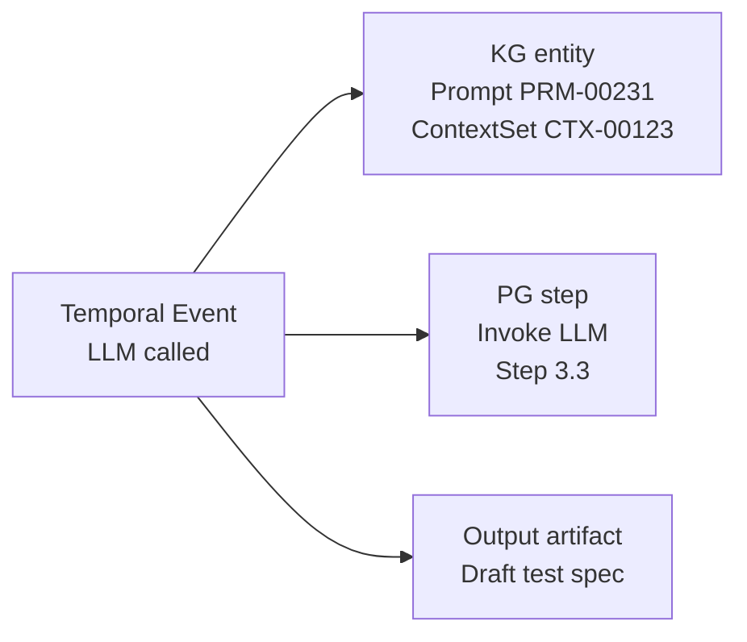

Every temporal event should be connected to:

| Link target       | Why                                              |
| ----------------- | ------------------------------------------------ |
| KG entities       | Shows what knowledge was used or produced.       |
| PG steps          | Shows which part of the procedure was executing. |
| Artifacts         | Shows inputs, outputs, intermediate results.     |
| Actors/components | Shows who or what performed the action.          |

---

## What the Temporal Graph captures

| Captured element        | Meaning                                  |
| ----------------------- | ---------------------------------------- |
| Timestamps              | When each event occurred.                |
| Actor/component         | Who or what performed the event.         |
| Input/output references | Artifacts, IDs, and data pointers.       |
| State changes           | How data and system state evolved.       |
| Decisions               | Choices made by rules, steps, or models. |
| Errors                  | Failures, exceptions, and error details. |
| Retries                 | Retry attempts and outcomes.             |
| Review events           | Human reviews, approvals, and feedback.  |

---

## Why it matters

| Reason               | Value                                                       |
| -------------------- | ----------------------------------------------------------- |
| Audit trail          | Complete, tamper-evident execution history.                 |
| Reproducibility      | Re-run or reproduce the same result using the same context. |
| Debugging            | Rapidly identify root causes.                               |
| Performance analysis | Measure durations, bottlenecks, and quality.                |
| Compliance           | Support regulatory and process obligations.                 |
| Post-hoc explanation | Explain why and how outputs were produced.                  |

---

## Conceptual 3-axis model

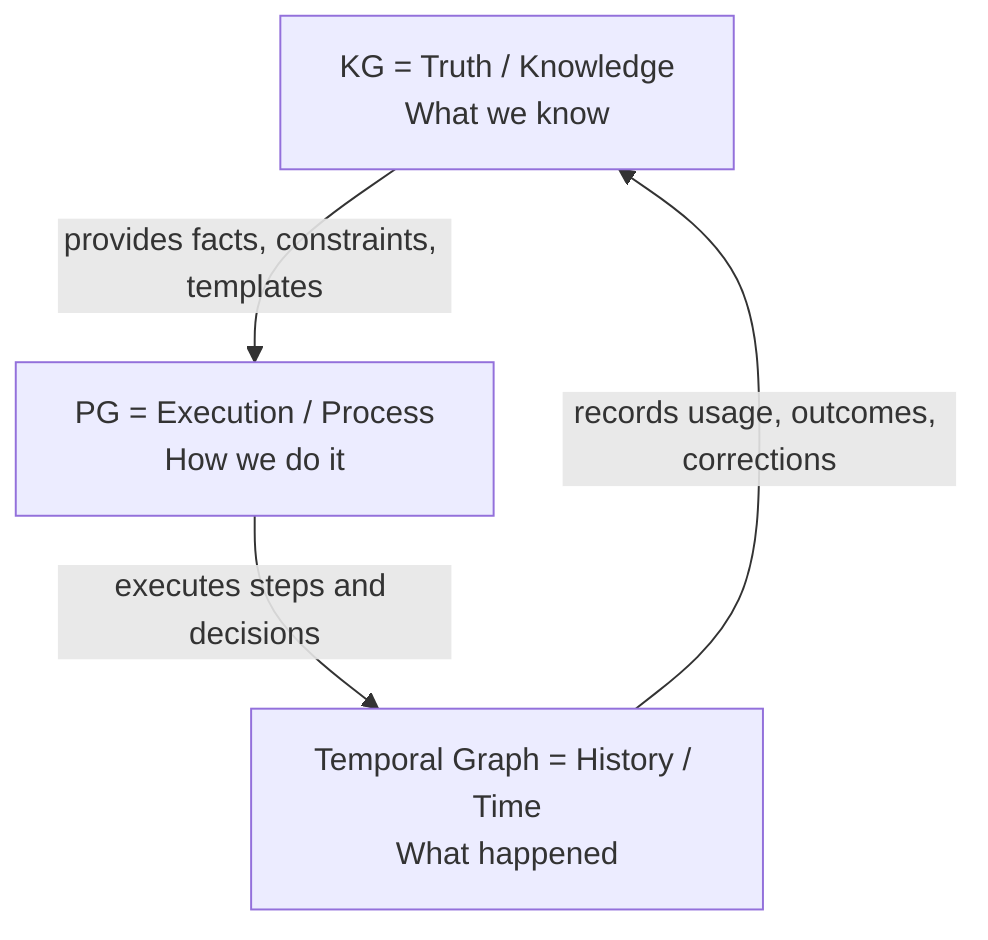

---

## Three complementary dimensions

| Dimension                           | Meaning                                                                                       | Main question           |
| ----------------------------------- | --------------------------------------------------------------------------------------------- | ----------------------- |
| **KG = Truth / Knowledge**          | Captures and organizes requirements, facts, rules, relationships, templates, and constraints. | What is true?           |
| **PG = Execution / Process**        | Defines executable procedures, steps, branches, loops, and decision logic.                    | How should it be done?  |
| **Temporal Graph = History / Time** | Records events over time and links actions to artifacts, actors, KG entities, and PG steps.   | What actually happened? |

---

## Final synthesis

The KG is the source of truth: **what we know**.

The PG embodies how processes are performed on specific inputs: **how we do it**.

The Temporal Graph shows what actually happened in each run: **what happened and when**.

Together, these three graphs enable the system to generate test cases for identified automotive requirements in a way that is:

| Quality      | Meaning                                                        |
| ------------ | -------------------------------------------------------------- |
| Auditable    | Every step can be inspected.                                   |
| Traceable    | Inputs, knowledge, procedure steps, and outputs are connected. |
| Debuggable   | Failures can be traced to causes.                              |
| Reproducible | Runs can be reconstructed.                                     |
| Evolvable    | Knowledge and procedures can improve over time.                |
